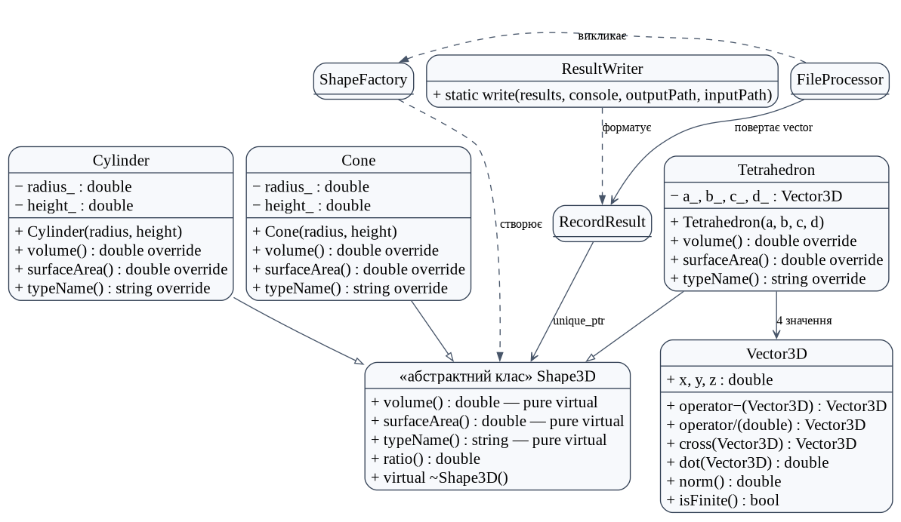
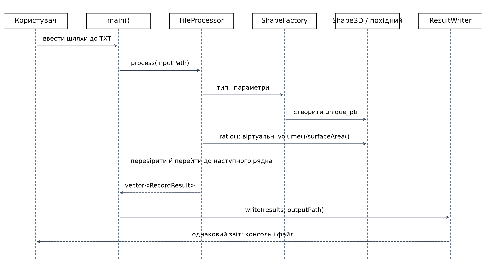
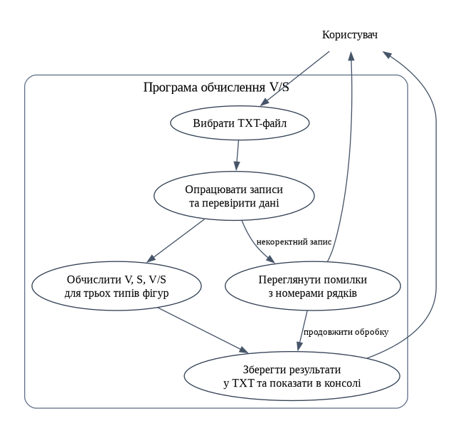
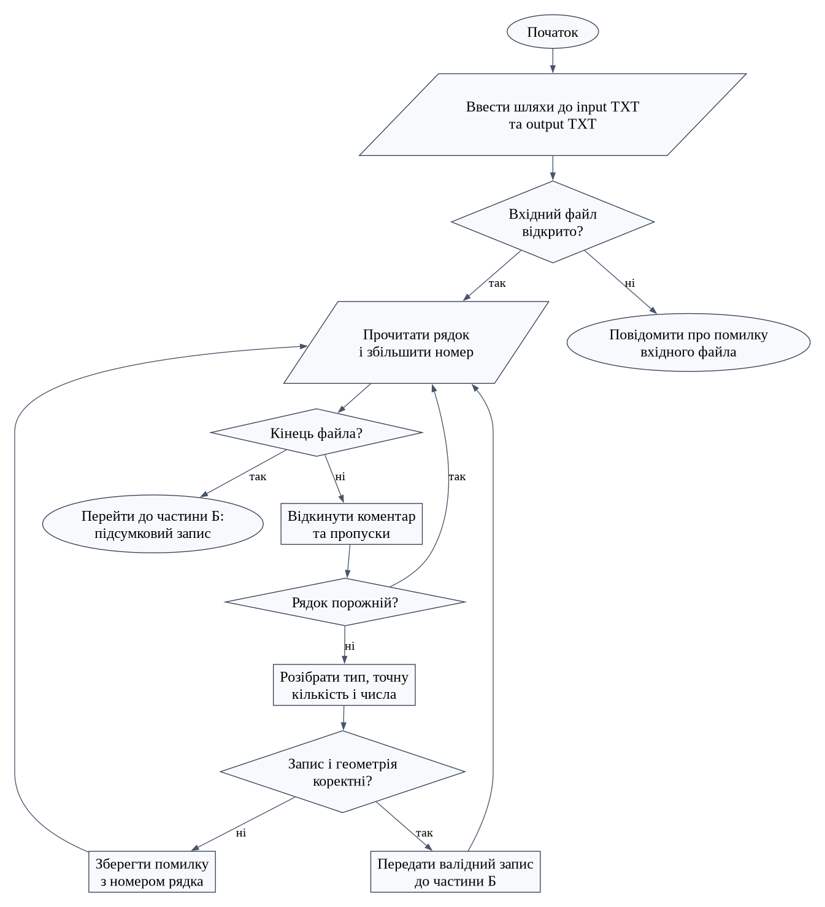
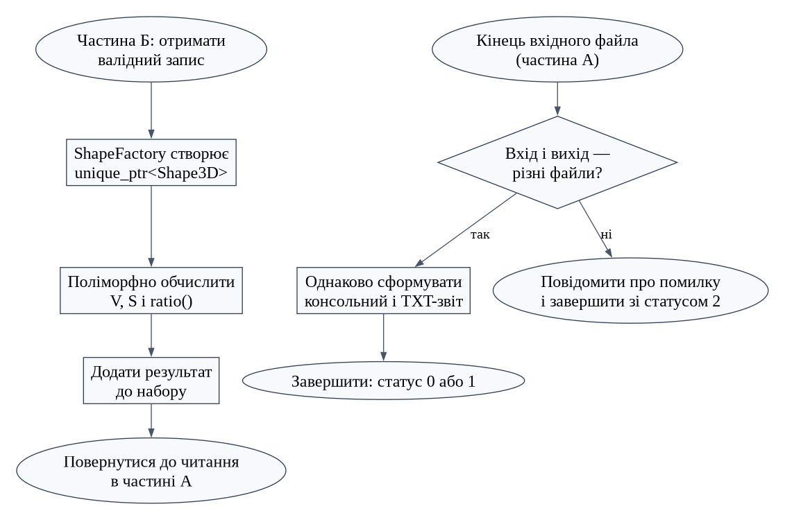
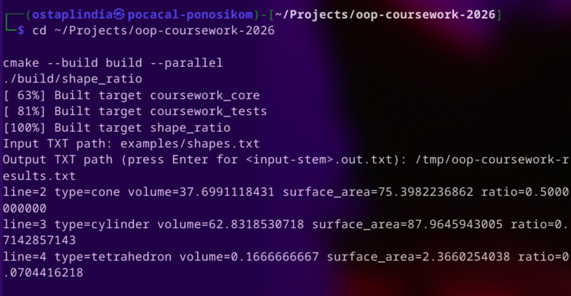

<!-- Source note: page breaks and administrative placeholders are intentional. -->
<!-- PAGE: cover -->
# ІВАНО-ФРАНКІВСЬКИЙ НАЦІОНАЛЬНИЙ ТЕХНІЧНИЙ УНІВЕРСИТЕТ НАФТИ І ГАЗУ

**Інститут інформаційних технологій**  
**Кафедра комп’ютерних систем і мереж**

## КУРСОВА РОБОТА

з дисципліни **«Об’єктно-орієнтоване програмування»**

### Тема

**«Розрахунок відношення об’єму фігури до її площі: конус, тетраедр, циліндр»**

**ПОЯСНЮВАЛЬНА ЗАПИСКА**

Позначення: **[КР.КІ–[номер залікової книжки].00.000.ПЗ — заповнити за правилами кафедри]**

Виконав: студент групи **КІ-26-1К**  
**Павлюк Остап Мирославович** ____________________

Керівник: **[посада, ПІБ керівника]** ____________________  
Допуск до захисту: **[заповнює керівник]**

Івано-Франківськ — 2026

<!-- NEXT_PAGE -->
<!-- PAGE: unframed -->
# ЗАВДАННЯ НА КУРСОВУ РОБОТУ

**Студент:** Павлюк Остап Мирославович  **Група:** КІ-26-1К  **Спеціальність:** 123 «Комп’ютерна інженерія»  
**Дисципліна:** Об’єктно-орієнтоване програмування

**Тема:** Розрахунок відношення об’єму фігури до її площі: конус, тетраедр, циліндр.  
**Варіант:** № 6 (підтверджений).  **Термін подання:** [з виданого завдання].

## Зміст завдання

1. Проаналізувати геометричну задачу та способи подання параметрів фігур.
2. Спроєктувати програму з базовим класом тривимірної фігури, спадкуванням і віртуальними методами.
3. Реалізувати читання набору геометричних даних із TXT-файла, перевірки та обчислення для конуса, тетраедра й циліндра.
4. Виводити результати на екран і у файл; для некоректних рядків повідомляти номер і продовжувати роботу.
5. Створити автоматизовані модульні перевірки та подати їх фактичні результати.

## Календарний план

| Етап | Плановий термін | Відмітка керівника |
|---|---|---|
| Аналіз задачі й математичної моделі | [дата] | [заповнити] |
| Проєктування класів, алгоритмів, форматів | [дата] | [заповнити] |
| Реалізація та тестування | [дата] | [заповнити] |
| Пояснювальна записка | [дата] | [заповнити] |
| Подання та захист | [дата] | [заповнити] |

Підпис студента: Павлюк О. М. ____________________  Підпис керівника: ____________________

<!-- NEXT_PAGE -->
<!-- PAGE: abstracts -->
# АНОТАЦІЯ

У записці розглянуто створення консольної програми мовою C++17 для варіанта № 6 курсової роботи з дисципліни «Об’єктно-орієнтоване програмування». Програма читає набори геометричних даних із текстового файла та обчислює відношення об’єму фігури до її повної зовнішньої площі поверхні. Реалізовано правий круговий конус, правий круговий циліндр і загальний тетраедр, заданий чотирма точками у тривимірному просторі.

Об’єктна модель використовує абстрактний базовий клас `Shape3D`, похідні типи фігур, віртуальні методи й поліморфне володіння через `std::unique_ptr`. Окремі компоненти відповідають за створення об’єктів, розбір і перевірку рядків та узгоджене консольне/файлове виведення. Перевіряються кількість і формат параметрів, скінченність чисел і виродженість тетраедра. Помилка містить номер рядка; оброблення набору після неї триває.

Автоматизований набір містить 66 тверджень у межах одного тестового запису CTest. Перевірено математичні еталони, масштабування, перестановку вершин, помилкові значення та узгодженість виведення. Debug і Release збірки пройшли. ASan/UBSan пройшли з вимкненим пошуком витоків; LeakSanitizer не виконався через ptrace-обмеження середовища.

**Ключові слова:** об’єктно-орієнтоване програмування, C++17, геометрична фігура, тетраедр, поліморфізм, модульне тестування, TXT-файл.

## ABSTRACT

This note describes a C++17 console application for variant 6 of the Object-Oriented Programming coursework. It reads geometric records from a text file and calculates the ratio of volume to total external surface area for a right circular cone, a right circular cylinder, and a general tetrahedron defined by four points in three-dimensional space.

The design uses an abstract `Shape3D` base class, derived shape classes, virtual functions, and polymorphic ownership through `std::unique_ptr`. Separate components construct shapes, parse and validate records, and produce matching console and file output. Validation covers parameter counts, decimal syntax, finite values, and degenerate tetrahedra. Invalid records carry line numbers and do not stop later records.

The automated suite contains 66 assertions in one CTest entry. Debug and Release builds passed. AddressSanitizer and UndefinedBehaviorSanitizer passed with leak detection disabled. LeakSanitizer could not run because of the execution environment’s ptrace restriction.

**Keywords:** object-oriented programming, C++17, geometric shape, tetrahedron, polymorphism, unit testing, text file.

<!-- SECTION: framed; CONTENTS -->
<!-- NEXT_PAGE -->
# ЗМІСТ

| Розділ | Стор. |
|---|---:|
| 1 Аналіз предметної області та математичних основ | 5 |
| 1.1 Постановка задачі та вимоги | 5 |
| 1.2 Математична модель відношення | 7 |
| 1.3 Правий круговий конус | 8 |
| 1.4 Правий круговий циліндр | 9 |
| 1.5 Загальний тетраедр | 10 |
| 1.6 Числова стійкість і TXT-формат | 11 |
| 2 Проєктування структури програмного забезпечення | 13 |
| 2.1 Компоненти та діаграма класів | 13 |
| 2.2 Абстрактний базовий клас і похідні типи | 15 |
| 2.3 Вектори, фабрика та створення об’єктів | 16 |
| 2.4 Файловий процесор і послідовність викликів | 17 |
| 2.5 Варіанти використання | 18 |
| 3 Реалізація програми та результати тестування | 19 |
| 3.1 Середовище та складання | 19 |
| 3.2 Фрагменти фактичного коду | 20 |
| 3.3 Алгоритм оброблення набору | 21 |
| Блок-схеми алгоритму | 22–23 |
| 3.4 Структура й охоплення тестування | 24 |
| 3.5 Фактичні результати перевірок | 25 |
| 3.6 Контрольні обчислення | 26 |
| 3.7 Консольний інтерфейс і скриншот | 27 |
| 3.8 Межі програми й відтворення | 28 |
| Висновки | 29 |
| Перелік використаних джерел | 30 |
| Декларація внеску генеративного ШІ | 31 |
| Додатки | 32–34 |

<!-- NEXT_PAGE -->
# 1 АНАЛІЗ ПРЕДМЕТНОЇ ОБЛАСТІ ТА МАТЕМАТИЧНИХ ОСНОВ

## 1.1 Постановка задачі та вимоги

Варіант № 6 методичних вказівок ІФНТУНГ [1] формулює задачу як розрахунок відношення об’єму фігури до її площі для конуса, тетраедра та циліндра. Для кожного коректного запису програма визначає тип фігури, перевіряє параметри й утворює результат із трьох величин: об’єм, площа та їх частка. У цій реалізації «площа» означає **повну зовнішню площу поверхні**. Методичний рядок завдання не уточнює, чи йдеться про повну або лише бічну поверхню; це рішення технічного базису, яке ще слід підтвердити в керівника.

Користувач задає шлях до TXT-файла через консоль. Файл може містити багато фігур. Валідний рядок дає числові результати; невалідний — номер рядка й пояснення. Помилка одного рядка не завершує оброблення решти файла. Результати записуються в консоль і вихідний файл з однаковим форматуванням. Програма демонструє абстрактний базовий клас, успадкування, віртуальні методи, інкапсуляцію та автоматичне керування ресурсами.

Для реалізації вибрано C++17, CMake і стандартну бібліотеку. Окремі компоненти відповідають за фігури, фабричне створення, розбір файла й виведення. Автоматизовані unit-тести перевіряють обчислення та сценарії роботи. Такий склад відповідає вимогам методики описати математичну інформацію, формати, структури, алгоритми, перевірки й результати тестування.

Одиниці вимірювання у програмі не задаються й не конвертуються. Користувач має вводити всі лінійні параметри узгоджено. Об’єм має розмірність довжини в кубі, площа — у квадраті, тому \(V/S\) має розмірність довжини, а не є безрозмірною величиною.

<!-- NEXT_PAGE -->
## 1.2 Математична модель відношення

Позначимо об’єм фігури через \(V\), а повну зовнішню площу через \(S\). Основна формула:

\[
R = \frac{V}{S}, \qquad V>0,\quad S>0.
\]

Додатність площі потрібна для визначеного ділення. Нульові розміри або компланарні точки не задають об’ємного тіла й відхиляються до обчислення результату. Програма не округлює проміжні значення; фіксовані десять цифр після десяткової крапки застосовуються тільки під час виведення.

Якщо всі лінійні розміри подібної фігури збільшити в \(k>0\) разів, об’єм зміниться в \(k^3\) разів, площа — в \(k^2\), а відношення — в \(k\):

\[
V'=k^3V,\quad S'=k^2S,\quad R'=kR.
\]

Це пояснює одиницю вимірювання результату й дає незалежну властивість для тестування числових обчислень на різних масштабах.

Параметри читаються як десяткові числа з крапкою: підтримуються знак, дробова частина й десятковий показник, наприклад `-1.5`, `.25`, `1.2e3`. Знак дозволений синтаксисом, але від’ємні геометричні розміри відхиляються. Текстові `nan`, `inf`, шістнадцяткові числа й значення з переповненням не є допустимими.

У тестах застосовується відносне порівняння з математичним еталоном, оскільки тип `double` має скінченну точність. Кількість знаків у надрукованому рядку не означає, що внутрішня арифметика має саме таку точність. Форматування результату — лише спосіб його стабільного відображення.

<!-- NEXT_PAGE -->
## 1.3 Правий круговий конус

Конус задається радіусом основи \(r>0\) і висотою \(h>0\). Його вісь проходить через центр основи й перпендикулярна до площини круглої основи. Реалізовано саме прямий круговий конус; довільний похилий конус набором цих двох параметрів не задається.

Твірна \(l\), радіус і висота утворюють прямокутний трикутник:

\[
l=\sqrt{r^2+h^2}.
\]

Об’єм дорівнює третині циліндра з тією самою основою та висотою:

\[
V_{к}=\frac{1}{3}\pi r^2h.
\]

Повна площа містить круглу основу й бічну поверхню:

\[
S_{к}=\pi r^2+\pi rl=\pi r(r+l).
\]

Відношення дорівнює \(R_{к}=V_{к}/S_{к}\), або після скорочення спільного множника \(\pi r\):

\[
R_{к}=\frac{rh}{3(r+l)}.
\]

У коді об’єм і повна площа обчислюються окремо, а базовий клас ділить їх. Це дає змогу перевіряти кожну геометричну характеристику тестом і виводити її користувачу. Значення \(\pi\) отримується через `std::acos(-1.0)`, а твірна — через `std::hypot`.

За \(r=3\), \(h=4\) твірна дорівнює 5, об’єм — \(12\pi\), площа — \(24\pi\), відношення — 0,5 одиниці довжини. Цей еталон присутній в автоматизованому тесті. Нульовий, від’ємний, нескінченний або чисельно вироджений параметр відхиляється конструктором.

<!-- NEXT_PAGE -->
## 1.4 Правий круговий циліндр

Циліндр задається радіусом круглої основи \(r>0\) та висотою \(h>0\). Його дві основи — рівні паралельні круги, а вісь перпендикулярна до площин основ. Похилий циліндр або тіло з еліптичними основами ця програма не моделює.

Об’єм є добутком площі основи на висоту:

\[
V_{ц}=\pi r^2h.
\]

Повна площа поверхні складається з двох основ і бічної поверхні. Остання розгортається у прямокутник зі сторонами \(2\pi r\) та \(h\):

\[
S_{ц}=2\pi r^2+2\pi rh=2\pi r(r+h).
\]

Звідси \(R_{ц}=V_{ц}/S_{ц}=rh/(2(r+h))\). Реалізація повертає об’єм та площу окремо, не округлює їх перед діленням і перевіряє скінченність результату.

Контрольне значення для \(r=2,h=5\): \(V=20\pi\), \(S=28\pi\), \(R=5/7\). Масштабні тести змінюють обидва параметри в \(10^{-100}\) та \(10^{100}\) разів і перевіряють очікувану лінійну зміну відношення. Тест із параметрами порядку \(10^{200}\) перевіряє, що непридатний результат не виводиться як звичайне число.

Текстовий формат рядка має форму `cylinder <radius> <height>`. Ідентифікатор задає інтерпретацію двох чисел; порядок аргументів є обов’язковим і документований у `README.md` та в прикладі даних. Одиниці користувач обирає самостійно, але вони мають бути узгодженими.

<!-- NEXT_PAGE -->
## 1.5 Загальний тетраедр

Тетраедр задається точками \(A,B,C,D\) у тривимірному просторі. Він загальний і не зобов’язаний бути правильним. Вхідний рядок містить дванадцять чисел: координати \(A\), потім \(B\), \(C\), \(D\), кожна вершина — трійка \((x,y,z)\).

Три вектори ребер з однієї вершини утворюють паралелепіпед. Абсолютний змішаний добуток визначає його об’єм; тетраедр займає шосту частину:

\[
V_{т}=\frac{|(B-A)\cdot((C-A)\times(D-A))|}{6}.
\]

Площа трикутної грані з точками \(P,Q,T\):

\[
S_{PQT}=\frac{1}{2}\|(Q-P)\times(T-P)\|.
\]

Повна площа й відношення:

\[
S_{т}=S_{ABC}+S_{ABD}+S_{ACD}+S_{BCD},\qquad R_{т}=V_{т}/S_{т}.
\]

Координатна форма задає довільний тетраедр і не вимагає припущення про однакові ребра. Перестановка точок змінює знак визначника залежно від парності перестановки, але модуль об’єму та сума чотирьох площ залишаються незмінними. Спільне перенесення усіх вершин не змінює різниць координат і геометрії.

Для вершин \((0,0,0),(1,0,0),(0,1,0),(0,0,1)\) об’єм дорівнює \(1/6\), повна площа — \((3+\sqrt3)/2\). Окремий еталон правильного тетраедра з ребром 1 перевіряє відому формулу \(V=\sqrt2/12\), \(S=\sqrt3\). Ці два тіла тестують різні геометричні випадки.

<!-- NEXT_PAGE -->
## 1.6 Числова стійкість, обмеження та файл

Для конуса й циліндра параметри мають бути додатними та скінченними. Координати тетраедра — скінченними; повторні вершини, компланарні й майже компланарні точки відхиляються. Помилкові десяткові токени, `nan`, `inf`, шістнадцятковий синтаксис, неповний чи надлишковий список аргументів не приймаються.

Нехай \(L\) — найбільша відстань між парами вершин тетраедра. У коді обчислюється нормований визначник \(|\det|/L^3\); значення не більше \(10^{-12}\) вважається виродженим. Ребра діляться на \(L\) перед визначником, щоб не формувати \(L^3\) у звичайній арифметиці. Для відновлення фізичного об’єму застосовується двійкове розкладання мантиси/порядку. Поріг масштабується з геометрією, але не усуває округлення координат типу `double`; дуже великий спільний зсув точок може втратити точність малих ребер.

Вхідний TXT — UTF-8, один запис на рядок; пробіли відділяють значення, `#` починає коментар, порожні рядки ігноруються. Формат: `cone r h`, `cylinder r h`, `tetrahedron Ax Ay Az Bx By Bz Cx Cy Cz Dx Dy Dz`. Кількість чисел перевіряється точно. Вихід містить номер рядка, тип, об’єм, повну площу та відношення; помилка запису містить номер і причину. За замовчуванням вихід називається `<input-stem>.out.txt`. Використано крапку, класичну локаль і десять знаків після крапки.

**Потребує підтвердження керівника:** повна площа замість лише бічної; правий круговий тип конуса й циліндра; загальний координатний тетраедр; поріг `1e-12`. Методичка ставить задачу та перелік фігур, але не деталізує ці математичні домовленості.

<!-- NEXT_PAGE -->
# 2 ПРОЄКТУВАННЯ СТРУКТУРИ ПРОГРАМНОГО ЗАБЕЗПЕЧЕННЯ

## 2.1 Компоненти та UML-класи

Заголовки публічних типів розміщені в `include/`, реалізації — в `src/`. `Shape3D` задає контракт геометрії; три похідні класи реалізують формули. `Vector3D` подає точку/вектор. `ShapeFactory` створює тип за ідентифікатором. `FileProcessor` читає й перевіряє рядки та формує результати. `ResultWriter` забезпечує консольне й файлове відображення. `main()` запитує шляхи й пов’язує етапи.

Залежності відповідають фактичному коду: процесор викликає фабрику; результат володіє фігурою через унікальний вказівник; тетраедр зберігає чотири вектори значень. Фабрика не зберігає стан; writer не обчислює геометрію; parser не форматує фізичні формули. Окремих GUI, конфігураційного сервісу чи журналу подій немає.



**Рисунок 2.1 — Діаграма класів програми**

<!-- NEXT_PAGE -->
## 2.2 Абстрактний базовий клас і похідні типи

Архітектура невелика, щоб зв’язки можна було пояснити на захисті. Кожен тип має чітку роль і може перевірятися окремо. Водночас поліморфізм використовується в робочому маршруті, а не лише існує як формальна ієрархія.

`Shape3D` є абстрактним завдяки трьом чистим віртуальним методам `volume()`, `surfaceArea()` і `typeName()`. Віртуальний деструктор забезпечує коректне знищення похідного об’єкта за базовим вказівником. `ratio()` є спільним невіртуальним методом: він запитує площу через віртуальну функцію, перевіряє її додатність і ділить об’єм на площу.

Реальний фрагмент `include/shape3d.hpp`:

```cpp
virtual ~Shape3D() = default;
virtual double volume() const = 0;
virtual double surfaceArea() const = 0;
virtual std::string typeName() const = 0;

double ratio() const {
    const double area = surfaceArea();
    if (!(area > 0.0)) throw std::domain_error("surface area must be positive");
    return volume() / area;
}
```

`Cone`, `Cylinder` і `Tetrahedron` успадковують базовий інтерфейс і позначають реалізації як `override`. Їхні параметри збережені у приватних полях; конструктори відхиляють невірну геометрію, а публічні методи не надають прямої зміни параметрів.

`FileProcessor` зберігає різні похідні типи у `std::unique_ptr<Shape3D>`. Під час `ratio()` базовий вказівник викликає методи фактичного класу через динамічну диспетчеризацію. Це і є runtime-поліморфізм у програмі. Унікальне володіння гарантує автоматичне звільнення, без ручного `new` та `delete`.

<!-- NEXT_PAGE -->
## 2.3 Вектори, фабрика та створення об’єктів

`Vector3D` зберігає три координати й реалізує віднімання, ділення на масштаб, скалярний і векторний добутки, евклідову норму та перевірку скінченності. Координати відкриті як у невеликому типі-значенні; точки в самому `Tetrahedron` зберігаються приватно. Відкрита структура спрощує математичні операції й не є інтерфейсом для довільної зміни вже створеного тіла.

`ShapeFactory::create(type, parameters)` спочатку перевіряє відомий ідентифікатор та точну кількість значень, потім викликає конструктор відповідної фігури. Для конуса й циліндра необхідно два числа, для тетраедра — дванадцять. Невідомий тип і помилкова кількість параметрів породжують `std::invalid_argument`. Геометричні обмеження перевіряються конструкторами фігур, тому фабрика не дублює формули чи правила додатності.

Фабрика повертає `std::unique_ptr<Shape3D>`, а не сирий вказівник. `RecordResult` містить або такий об’єкт, або текст помилки та номер рядка. Об’єкт живе, поки його результат зберігається у векторі; після завершення writer-виведення або знищення вектора пам’ять звільняється автоматично.

Для координат тетраедра фабрика лише групує числа в чотири трійки. `Tetrahedron` відповідає за відстані, виродженість, площі й об’єм. Таке розмежування залишає парсер незалежним від деталей геометричного алгоритму.

<!-- NEXT_PAGE -->
## 2.4 Файловий процесор і послідовність викликів

`FileProcessor::process(path)` відкриває вхідний файл, рахує фізичні рядки, відкидає текст коментаря після `#`, пропускає порожній вміст і розбирає кожен запис окремо. Десятковий токен перевіряється граматично та через `std::strtod`; `errno`, повне споживання токена і скінченність значення є умовами успіху. Помилка одного рядка перехоплюється, зберігається в результаті й не зупиняє читання.

Після повного читання `main()` передає вектор результатів `ResultWriter`. Він спершу перевіряє збіг шляхів, формує повний текст у буфері й подає той самий текст у консоль та файл. Псевдонімні шляхи нормалізуються; якщо обидва файли існують, перевіряється їхня еквівалентність файловою системою.



**Рисунок 2.2 — Діаграма послідовності оброблення файла**

<!-- NEXT_PAGE -->
## 2.5 Варіанти використання

Основний сценарій: запустити програму, ввести шлях до TXT, погодитися з типовим виходом або вказати власний і переглянути звіт. Помилки записів показуються з номером рядка, після чого читання триває.



**Рисунок 2.3 — Діаграма варіантів використання програми**

Інтерфейс консольний; шлях приймає пробіли. Типовий вихід — `<input-stem>.out.txt`. Колізії канонічних, символічних і жорстких посилань відхиляються. Помилки записів дають частковий звіт із ненульовим статусом; файлові помилки припиняють виконання.

<!-- NEXT_PAGE -->
# 3 РЕАЛІЗАЦІЯ ПРОГРАМИ ТА РЕЗУЛЬТАТИ ТЕСТУВАННЯ

## 3.1 Середовище та складання

Застосунок написано мовою C++17. Нижче описано фактичний програмний базис [2]. `CMakeLists.txt` встановлює стандарт 17, робить його обов’язковим і вимикає нестандартні розширення. Цілі збірки: бібліотека `coursework_core`, виконуваний файл `shape_ratio` та, з увімкненим `BUILD_TESTING`, тестовий виконуваний файл `coursework_tests`. CTest реєструє один тестовий запис.

Код використовує стандартну бібліотеку: потоки, рядки, контейнери, файлову систему, математичні функції та `std::unique_ptr`. Для GCC/Clang увімкнено `-Wall -Wextra -Wpedantic -Wconversion -Wshadow`; для MSVC — `/W4 /permissive-`.

Відтворення Release-збірки з кореня проєкту:

```sh
cmake -S . -B build -DCMAKE_BUILD_TYPE=Release
cmake --build build --parallel
ctest --test-dir build --output-on-failure
./build/shape_ratio
```

Debug аудит виконувався окремо в `build-audit` із додатковими попередженнями. Санітизований варіант використовував `-fsanitize=address,undefined -fno-omit-frame-pointer` при компіляції та `-fsanitize=address,undefined` при компонуванні. Каталоги збірок не додаються до репозиторію завдяки `.gitignore`.

<!-- NEXT_PAGE -->
## 3.2 Фрагменти фактичного коду

Реальна реалізація площі конуса з `src/cone.cpp`:

```cpp
double Cone::surfaceArea() const {
    const double slant = std::hypot(radius_, height_);
    const double result = std::acos(-1.0) * radius_ * (radius_ + slant);
    ensureFinite(result);
    return result;
}
```

Вона включає круглу основу та бічну поверхню. Конструктор попередньо вимагає скінченних додатних параметрів і перевіряє, що об’єм та площа чисельно залишаються скінченними й додатними.

Фрагмент перевірки тетраедра з `src/tetrahedron.cpp`:

```cpp
const double normalizedDet = normalizedDeterminant(a_, b_, c_, d_, scale);
ensureFinite(normalizedDet);
if (std::abs(normalizedDet) <= 1e-12) {
    throw std::invalid_argument("tetrahedron is degenerate or nearly coplanar");
}
```

У `volume()` нормований визначник повертається до фізичного масштабу через `std::frexp` і `std::scalbn`, що запобігає проміжному переповненню там, де кінцевий результат ще представний. Границі тетраедра обчислюються як сума чотирьох площ трикутників.

Наведені фрагменти відповідають файлам поточного базису; не описуються додаткові можливості на кшталт GUI, перетворення одиниць, конфігураційного файла або журналу, яких у реалізації немає.

<!-- NEXT_PAGE -->
## 3.3 Алгоритм оброблення набору

Після запиту шляхів `main()` викликає файловий процесор. Той відкриває файл, послідовно читає рядки й відмічає їхні вихідні номери. Коментарі відкидаються, порожні рядки пропускаються. Для іншого рядка зчитується тип та список десяткових параметрів. Перевіряються точна кількість значень, формат і скінченність. Фабрика створює об’єкт, конструктор перевіряє геометрію, після чого викликається спільний `ratio()` через базовий інтерфейс.

Успішний результат накопичується разом з об’єктом. Помилка запису перехоплюється локально, щоб цикл міг перейти далі. Після кінця файла порожній логічний набір відхиляється. Writer перевіряє, що шляхи різні, формує текст один раз, виводить його на екран та у файл. Після завершення програма повертає код, який розрізняє повний успіх, некоректні записи й фатальну помилку файла.

<!-- NEXT_PAGE -->
## Блок-схема алгоритму оброблення набору

Алгоритм поділено на два послідовні креслення, щоб назви вузлів залишались читабельними при друці. Частина А охоплює запит шляхів, читання рядка, розбір і перевірку вхідних даних.



**Рисунок 3.1а — Блок-схема оброблення файла: читання та перевірка**

<!-- NEXT_PAGE -->
## Блок-схема оброблення: обчислення та запис

Частина Б показує створення поліморфного об’єкта, обчислення характеристик, накопичення результатів і фінальне формування узгодженого звіту. Перехід до читання наступного рядка повертає керування до частини А.



**Рисунок 3.1б — Блок-схема оброблення: обчислення й виведення**

<!-- NEXT_PAGE -->
## 3.4 Структура й охоплення тестування

`tests/test_main.cpp` — легкий тестовий каркас на стандартній бібліотеці. Функція `check` рахує твердження, `near` порівнює числа з відносним допуском, `throws` підтверджує виняткові сценарії. Тестова програма групує математичні, валідаційні й файлові перевірки; CTest запускає один виконуваний файл, усередині якого є 66 окремих тверджень.

Перевіряються формули трьох фігур, відношення, правильний тетраедр, перенесення й перестановка вершин, масштаби `1e-100` та `1e100`, великі координати з представним кінцевим об’ємом, відхилення переповнення/підтікання й майже компланарність. Файлові сценарії включають точну кількість аргументів, невідомий тип, текст замість числа, `nan`, `inf`, hexfloat, коментарі, порожній файл, відсутній файл, змішаний набір і помилку запису.

Перевіряється побайтовий збіг консольного й файлового виводу. Перевірку колізій виконано для ідентичного, нормалізованого відносного, символьного й жорсткого посилання. Тестове оточення використовує унікальну тимчасову теку й прибирає тільки її вміст.

66 — це кількість assertion-перевірок, а не кількість CTest-записів і не відсоток покриття рядків коду. CTest показує один зареєстрований тест, що пройшов; покриття інструментом вимірювання не запускалось.

<!-- NEXT_PAGE -->
## 3.5 Фактичні результати перевірок

Release: `cmake --fresh -S . -B build -DCMAKE_BUILD_TYPE=Release`, збірка всіх цілей та `ctest --test-dir build --output-on-failure` пройшли. CTest повідомив **1/1 passed**, прямий запуск — **All 66 assertions passed**.

Debug: конфігурація `build-audit` із `-Wconversion -Wshadow -Wpedantic`, збірка і CTest пройшли; **1/1**, **66 assertions passed**.

ASan/UBSan: інструментована збірка та CTest пройшли; прямий тест повідомив **66 assertions passed** із `ASAN_OPTIONS=detect_leaks=0`. Початковий запуск LeakSanitizer із пошуком витоків завершився повідомленням про неможливість роботи під ptrace. Тому LeakSanitizer **не верифіковано**; результат не слід трактувати як перевірку відсутності витоків.

Контрольний sample-run завершився кодом 0; вихідний файл побайтово збігся з очікуваними даними. Некоректний параметр повернув код 1 після обробки наступного запису. Відсутній вхід повернув код 2. Ці значення взяті з фактичного запуску; жоден тестовий результат не вигадано.

<!-- NEXT_PAGE -->
## 3.6 Контрольні обчислення

Файл прикладу задає конус \((r,h)=(3,4)\), циліндр \((r,h)=(2,5)\), тетраедр із вершинами \((0,0,0),(1,0,0),(0,1,0),(0,0,1)\). Фактичний вивід:

```text
line=2 type=cone volume=37.6991118431 surface_area=75.3982236862 ratio=0.5000000000
line=3 type=cylinder volume=62.8318530718 surface_area=87.9645943005 ratio=0.7142857143
line=4 type=tetrahedron volume=0.1666666667 surface_area=2.3660254038 ratio=0.0704416218
```

Для конуса значення відповідають \(12\pi,24\pi,0.5\); для циліндра — \(20\pi,28\pi,5/7\); для координатного тетраедра — \(1/6,(3+\sqrt3)/2\) і частці цих двох величин. Десяткові рядки округлені лише під час виведення.

Тест правильного тетраедра з ребром 1 окремо перевіряє \(V=\sqrt2/12\), \(S=\sqrt3\) і \(R=1/(6\sqrt6)\). Геометрія початкового тетраедра не є правильною; тому її результат не підміняється формулами правильного тіла.

<!-- NEXT_PAGE -->
## 3.7 Консольний інтерфейс і скриншот

Інтерфейс починається запитом `Input TXT path:`, потім показує `Output TXT path (press Enter for <input-stem>.out.txt):`. Після введення шляхів програма друкує один рядок для кожного геометричного запису. Успішний рядок має поля `line`, `type`, `volume`, `surface_area`, `ratio`; помилка — `line`, `type`, `error`. Текст у консолі повторює файл.

Текстові докази фактичного запуску (вхід, консоль і вихідний файл; код 0) збережено в каталозі `evidence/`. На рисунку 3.2 наведено знімок консолі під час запуску програми на наборі `examples/shapes.txt`. Результати трьох фігур збігаються зі збереженим консольним виводом і вихідним файлом.



**Рисунок 3.2 — Результати обчислень конуса, циліндра й тетраедра під час запуску програми**

Знімок показує виконання застосунку та числові результати; доказовими файлами для повного набору рядків також є журнали консольного запуску й вихідного TXT-файла.

<!-- NEXT_PAGE -->
## 3.8 Межі програми й відтворення

Програма не підтримує перетворення одиниць або додаткових форматів. Користувач узгоджує одиниці самостійно. Координати дуже малого тіла зі значним спільним зсувом можуть втрачати точність при відніманні в `double`; нормалізація визначника захищає критерій від масштабу, але не може відновити втрачені вхідні біти. Числа, площі чи об’єми, що переповнюються або занулюються, відхиляються.

Збірці потрібні сумісний компілятор C++17 і CMake 3.16 чи новіший. Тестовий каркас не має сторонніх залежностей. Приклад TXT збережено в `examples/`; команди будування є в `README.md`. Build-каталоги виключені `.gitignore`.

Перед захистом студент має особисто відтворити збірку, перевірити математичні результати й погодити непідтверджені академічні рішення, а також заповнити адміністративні поля. Тут не заявляється схвалення викладача, дата захисту чи оцінка. За прийняті рішення та достовірність фінальної роботи відповідає студент.

<!-- NEXT_PAGE -->
# ВИСНОВКИ

Реалізовано консольну програму C++17 для варіанта № 6: набір геометричних даних читається з TXT-файла, обчислюються об’єм, повна зовнішня площа та їх відношення для правого кругового конуса, правого кругового циліндра й загального тетраедра за чотирма вершинами.

На аналітичному етапі визначено формат записів та параметри. На математичному етапі реалізовано формули трьох фігур і перевірку розмірності результату. У програмному проєктуванні використано абстрактний базовий клас, спадкування, віртуальні методи, фабричне створення та окремі компоненти файлового введення й виведення. Тестування підтвердило математичні еталони, крайні масштаби, помилкові записи, продовження після помилки та збіг консолі з файлом.

Release і Debug збірки та CTest пройшли; 66 assertions успішні. ASan/UBSan пройшли з вимкненим leak detection. LeakSanitizer залишився невиконаним через ptrace-обмеження.

Рішення трактувати площу як повну, використовувати правий круговий конус/циліндр, загальний координатний тетраедр і поріг `1e-12` потребують підтвердження керівника. До остаточного друку потрібно оновити календарний план і перевірити фактичну пагінацію.

<!-- NEXT_PAGE -->
# ПЕРЕЛІК ВИКОРИСТАНИХ ДЖЕРЕЛ

1. Мельничук С. І. **Методичні вказівки до виконання курсової роботи з дисципліни «Об’єктно-орієнтоване програмування»** для студентів спеціальності 123 «Комп’ютерна інженерія». Івано-Франківськ: ІФНТУНГ, 2026. 20 с.

2. **Програмна реалізація курсової роботи, варіант № 6**: вихідні файли C++17 (`include/`, `src/`), автоматизовані тести (`tests/test_main.cpp`), приклад даних (`examples/shapes.txt`) і конфігурація CMake (`CMakeLists.txt`). Базис `8b291b9e39cc176d4d8aa19bdcb6be3e1e6ab1d9`, гілка `feature/oop-course-004-documentation`. Електронний ресурс проєкту, 2026.

У тексті використано методичні вказівки для вимог до завдання та пояснювальної записки й фактичні вихідні файли для опису реалізації. Інших книжок або вебресурсів як прочитаних джерел не заявлено. Додаткові матеріали, якщо їх буде використано студентом, слід реально опрацювати, процитувати в тексті та оформити за вимогами кафедри.

<!-- NEXT_PAGE -->
# ДЕКЛАРАЦІЯ ВНЕСКУ ГЕНЕРАТИВНОГО ШТУЧНОГО ІНТЕЛЕКТУ

Під час підготовки курсового програмного проєкту та цієї чернетки використано:

- **ChatGPT — OpenAI:** допомога в структуруванні вимог і плану записки, формулюванні пояснень та підготовці українськомовного тексту.
- **Codex — OpenAI:** допомога в реалізації C++17-класів і тестів на попередньому етапі, аудиті математичних формул і файлової обробки, перевірці тестів, підготовці вихідного тексту й діаграм.

Інструменти застосовувалися для аналізу вимог, проєктування, програмування, тестування та підготовки документаційних матеріалів. Наведені результати збірки й тестів походять із фактичних запусків. Підписи, схвалення керівника й оцінки не генерувалися.

**Відповідальність:** студент — автор курсової роботи — несе повну відповідальність за перевірку, точність, остаточний зміст і подання. Перед поданням студент має перевірити декларацію та засвідчити її за вимогами кафедри.

ПІБ: Павлюк О. М.  Дата: [заповнити]  Підпис: ____________________

<!-- SECTION: appendix -->
<!-- NEXT_PAGE -->
# ДОДАТОК А. ВХІДНИЙ НАБІР ДАНИХ

Фактичний файл `examples/shapes.txt`:

```text
# Variant 6 sample: radius/height for round shapes, four vertices for tetrahedron.
cone 3 4
cylinder 2 5
tetrahedron 0 0 0  1 0 0  0 1 0  0 0 1
```

<!-- NEXT_PAGE -->
# ДОДАТОК Б. ФАКТИЧНИЙ ВИХІДНИЙ ПРОТОКОЛ

```text
line=2 type=cone volume=37.6991118431 surface_area=75.3982236862 ratio=0.5000000000
line=3 type=cylinder volume=62.8318530718 surface_area=87.9645943005 ratio=0.7142857143
line=4 type=tetrahedron volume=0.1666666667 surface_area=2.3660254038 ratio=0.0704416218
```

<!-- NEXT_PAGE -->
# ДОДАТОК В. АДМІНІСТРАТИВНІ ДАНІ ДЛЯ РУЧНОГО ЗАПОВНЕННЯ

Дані студента: Павлюк Остап Мирославович, група КІ-26-1К. Перед друком потрібно перенести з виданого завдання номер залікової книжки, документне позначення, дату видачі, термін подання й календарний план. Підпис і допуск заповнюють тільки відповідні особи.

Знімок фактичного запуску наведено в розділі 3.7. Після подальших змін верстки треба оновити зміст і номери сторінок, а також підтвердити з керівником повну площу, параметризацію круглих тіл, координатну модель тетраедра та числовий поріг виродженості. Жодне поле не заповнювати вигаданими даними.
